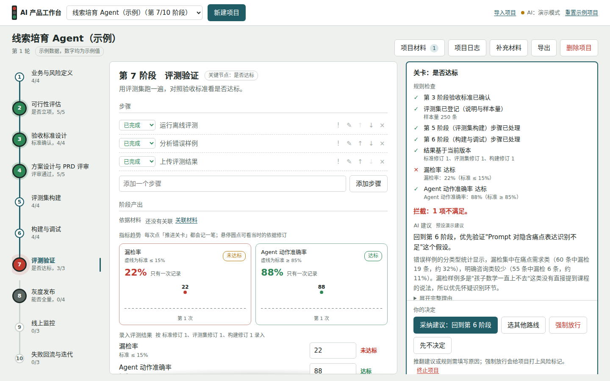

# AI 产品工作台

帮助 AI 产品经理在评测、灰度等关键节点，**依据事先确认的标准和实测结果，决定推进还是返工，并保留当时的依据。**



更多截图见 [docs/screenshots](docs/screenshots)：返工、依据快照、旧结果过期、指标趋势、批准人、导出、新建项目。

## 它解决什么问题

一个具体的场景：信号识别 Agent 的步骤全部完成了，但离线评测的漏检率是 22%，而立项时约定的标准是不高于 15%。

- 在普通的任务看板里，步骤都打了勾，项目就"完成了"，很容易在进度压力下直接灰度；
- 在这个工作台里，第 7 关「是否达标」会拦下这次推进。产品经理可以采纳 AI 的返工建议，也可以强制放行，但强制放行必须写明原因，项目会被打上风险标记；
- 之后任何时候打开这次决定，都能看到当时的规则明细、实测值与阈值、AI 的完整建议，以及你为什么这么选。

它的价值不在"有十个阶段"或"有日志"，而在于让 AI 项目里最容易出问题的几个决定——标准有没有定、结果达没达标、结果是不是按当前版本测的——都有据可查。

## 核心机制：三层分工

| 层 | 负责 | 特点 |
|---|---|---|
| 规则层 | 能不能走 | 只检查客观条件（填没填、数字达没达标、结果是不是当前版本），结果确定 |
| AI 建议层 | 建议怎么走 | 给出建议、理由、验证方法和备选路线；证据不足时写成待验证的假设 |
| 产品经理 | 最终怎么走 | 采纳、选其他路线、强制放行或终止项目；推翻建议必须写原因 |

几条保证机制成立的规则：

- **所有推进走同一个入口**：拍板的那一刻重新检查规则，前进一次只能走一步；打开关卡后改了数据，旧的检查结果和建议会标记为过期，必须重新检查。
- **结果绑定依据修订**：验收标准、评测集、构建各有修订号（本工具记录的依据修订次数，不是 Prompt 版本）。所有修改走同一个变更入口，按依赖关系表决定哪些关卡失效；已通过的关卡在依据变化后会被复核，不再满足就撤销。改完构建，之前测出来的成绩不能继续使用。
- **记录谁拍板**：关卡放行、强制放行都要填写批准人和意见，写进决策记录和决策报告。工具是单人使用的，它不替代审批流程，只把"谁批准的"留在依据里。
- **每次决定保存依据快照**：规则明细、指标实测与阈值、相关阶段产出、依据修订、关联材料、AI 完整建议。

## 默认流程：10 个阶段

| # | 阶段 | 关键节点 |
|---|---|---|
| 1 | 业务与风险定义 | |
| 2 | 可行性评估 | 是否立项 |
| 3 | 验收标准设计 | 标准确认 |
| 4 | 方案设计与 PRD 评审 | 评审通过 |
| 5 | 评测集构建 | |
| 6 | 构建与调试 | |
| 7 | 评测验证 | 是否达标 |
| 8 | 灰度发布 | 能否全量 |
| 9 | 线上监控 | 继续监控 / 发起迭代 / 结束项目 |
| 10 | 失败回流与迭代 | |

这是面向 AI 项目的**默认流程**，不是行业统一标准。核心思路是评测前置：先在第 3 阶段定下验收标准，再开始构建；线上失败回流成新的评测用例。方向上参考了 [LangChain 的 Agent 开发生命周期](https://www.langchain.com/blog/the-agent-development-lifecycle)（构建、测试、部署、监控的循环），以及一篇关于验收测试驱动评估的预印本论文（[arXiv 2606.02755](https://arxiv.org/pdf/2606.02755)）。这些资料支持"评测前置、失败回流"的方向，但不能证明这十个阶段适用于所有项目，也不能证明这个工具已经带来业务收益。

关于同类工具：我在 GitHub 上看过几个相近的开源项目（把 PRD 拆成任务、带阶段关卡的命令行工具等），它们主要面向开发者。这只是有限范围的观察，不是系统的竞品研究。

## 快速开始

**不想装任何东西**：直接双击 `demo/ai-pm-workbench-demo.html`，用浏览器打开就能体验（演示模式）。

**完整版**：需要 Node.js 18 或以上，没有任何第三方依赖。

```bash
git clone <你的仓库地址>
cd ai-pm-workbench
node server.js                 # 打开 http://localhost:3000
node tests/engine.test.js      # 推进引擎与规则的单元测试
python3 tests/browser_test.py  # 浏览器回归测试（需要 pip install playwright 并安装 chromium）
```

首次打开自带示例项目「线索培育 Agent」，停在第 7 阶段。新建项目可以一次上传多个文件（Markdown、TXT、Word、PDF、CSV、JSON），AI 逐个判断类型，以进度最靠后的文件判断「当前工作阶段」；更早的阶段标记为「未核验」，需要对照材料确认。项目推进中可以随时「补充材料」，并把材料关联到某个阶段作为依据。

### 接入大模型（可选）

不配置也能用，此时运行在**演示模式**：文件分类、项目命名和建议由关键词规则与模板生成，示例项目第 7 关的建议是**预设的演示建议**，界面上都有标注。演示模式验证的是交互和控制逻辑，不能证明模型的分析质量。

接入真实模型：

```bash
cp .env.example .env    # 填写服务商地址、Key 和模型名
node server.js
```

任何兼容 OpenAI `chat/completions` 接口的服务都可以（DeepSeek、通义千问兼容模式、Kimi、OpenAI 等），地址和模型名以服务商文档为准。Key 只保存在服务端。模型调用超时或失败时自动降级到演示模式，并提示原因。

## 三分钟演示路线

| 时间 | 操作 | 要讲的点 |
|---|---|---|
| 0:00–0:20 | 打开示例项目，说明数字是示例值、建议是预设模板 | 项目任务都做完了，但这不代表能上线 |
| 0:20–0:50 | 点「推进关卡：是否达标」，指出漏检率 22% 超过标准 15% | 推进依据来自事先确认的标准，不是进度 |
| 0:50–1:30 | 展示 AI 建议：分类型统计、待验证的假设、验证方法、备选路线 | AI 提出可验证的判断，产品经理做选择 |
| 1:30–2:00 | 点「采纳建议」，看第 6 阶段新增的返工步骤和「构建依据修订」记录 | 决定变成下一步工作；改完构建，之前的成绩不能再用 |
| 补充 | 返工完成后重新录入 12%，第 7 阶段的「指标趋势」卡片显示 22% 到 12%；过关时填写批准人 | 迭代有没有用一眼可见；每次放行都写明是谁批准的 |
| 2:00–2:40 | 在决策记录里点「查看当时依据」 | 任何时候都能回答"当时为什么这么走" |
| 2:40–3:00 | 说明也支持强制放行（必须写原因、打风险标记）和终止项目 | 人可以做例外决定，系统把风险显式记录下来 |

强制放行、多文件解析可以放到追问环节演示。演示前点右上角「重置示例项目」恢复初始状态。

## 目录结构

```
├── server.js                  零依赖服务：静态页面 + 模型代理
├── .env.example               模型配置模板
├── demo/
│   └── ai-pm-workbench-demo.html   单文件演示版，双击即可打开
├── public/                    完整版前端
│   ├── index.html
│   ├── styles.css
│   └── js/
│       ├── stages.js          10 个阶段的默认骨架
│       ├── rules.js           规则层：关卡检查、结果修订、下一步计算
│       ├── engine.js          推进引擎：统一推进与变更入口、依赖关系表、关卡复核、指标历史、依据快照
│       ├── ai.js              建议层：模型模式 / 演示模式
│       ├── store.js           数据存储与示例项目
│       ├── files.js           多文件解析
│       └── app.js             界面与交互
├── tests/
│   ├── engine.test.js         推进引擎与规则的单元测试
│   └── browser_test.py        浏览器回归测试（37 项）
├── examples/
│   ├── 客服工单自动分类_示例项目包/   6 份不同格式的虚构项目文档，用来体验多文件解析
│   └── 示例_决策报告.md        导出的决策报告样例
└── docs/
    ├── 01_需求文档.md
    ├── 02_技术方案.md
    ├── 03_第一轮评审处理说明.md
    ├── 04_第二轮评审处理说明.md
    ├── 05_竞品与界面调研.md
    ├── 06_演示脚本.md
    ├── screenshot.png
    └── screenshots/
```

## 文档

| 文档 | 内容 |
|---|---|
| [需求文档](docs/01_需求文档.md) | 定位、功能清单、关卡准入规则、明确不做的范围、已知局限 |
| [技术方案](docs/02_技术方案.md) | 三层结构、推进规则、依赖关系表、测试 |
| [第一轮评审处理说明](docs/03_第一轮评审处理说明.md) | 外部评审提出的 19 个问题及处理方式 |
| [第二轮评审处理说明](docs/04_第二轮评审处理说明.md) | 复核后的 13 个新问题及处理方式，以及参考竞品新增的三项功能 |
| [竞品与界面调研](docs/05_竞品与界面调研.md) | GitHub 相关项目对比，评测与发布工具的界面参考 |
| [演示脚本](docs/06_演示脚本.md) | 演示准备、三分钟主线、追问时的补充演示、常见追问 |

## 已知局限

- 步骤状态和评测数字由产品经理录入。规则检查的是"数据是否满足约定"，不能认证数据真实；系统通过版本、依据快照和"推翻须留痕"提高可核查性，不宣称不可篡改。
- 数据保存在浏览器本地。「导出」有两种：决策报告（Markdown，可直接发给业务方）和项目备份（JSON，用「导入项目」恢复）。
- Word、PDF 解析组件需要联网加载；扫描版 PDF 读不出文字。超过 2 万字的文件只保存前 2 万字，并在材料里标明。
- 尚未做目标用户验证，没有效率提升的数据。
